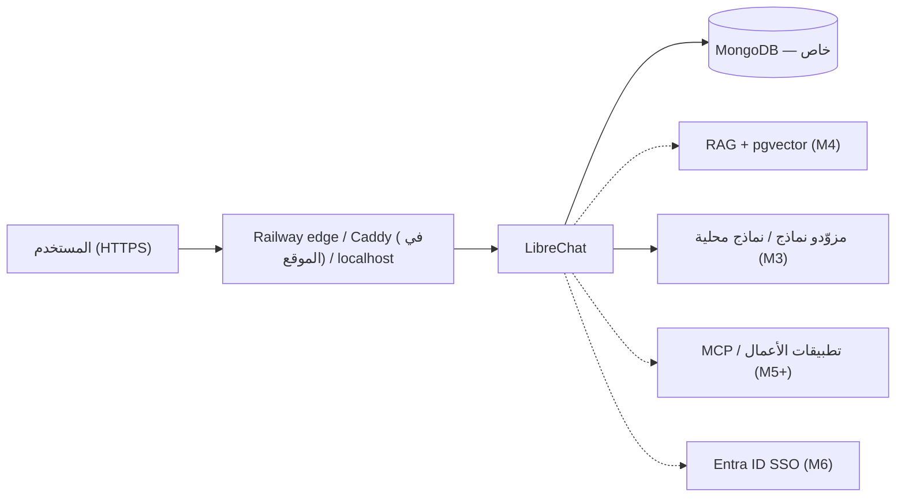

# EF AI Workspace — بصير (اسم عمل مؤقت)

منصّة ذكاء اصطناعي توليدي مؤسسية، **عربية أولاً وثنائية اللغة**، لمنسوبي **صندوق البيئة (Environment Fund)** في المملكة
العربية السعودية، مبنية على [LibreChat](https://github.com/LibreChat-AI/LibreChat) مفتوح المصدر.

**اسم العمل (مؤقت):** «بصير | صندوق البيئة» — اختاره مالك المشروع اسماً عملياً قابلاً للتغيير، ويُضبط بـ `APP_TITLE`؛
حالة ظهوره على Railway في [CURRENT_STATE](project/CURRENT_STATE.md). اعتماد الاسم المؤسسي والهوية البصرية ما زال ضمن
[D-04](docs/design/brand-guidelines.md) ([#7](https://github.com/faenazi/ef-ai-workspace/issues/7)).

> **تنبيه أمني:** مستودع خاص. **بيانات اصطناعية فقط** في التطوير والعرض. لا أسرار، ولا بيانات موظفين، ولا مستندات سرية
> في هذا المستودع أو في بيئة العرض. انظر [SECURITY.md](SECURITY.md).

## ابدأ من هنا — للمالك والمطور ووكلاء الذكاء الاصطناعي

**نقطة الدخول الموحدة لأي محادثة جديدة:** [START_HERE](project/START_HERE.md)، ثم
[الحالة المتحققة](project/CURRENT_STATE.md) ← [خارطة الطريق](project/ROADMAP.md) (الإصدارات R0.x، المراحل M0–M8،
ترتيب التنفيذ) ← الـ Issues الحية. التاريخ (التقارير، التخطيط الأصلي، سجلات الحالة القديمة) في [docs/history/](docs/history/README.md).
[تعريف الإنجاز](docs/quality/definition-of-done.md) يحدد البوابات والمسؤوليات؛ لا تخلط بين **خطة معتمدة** و**ميزة تعمل**.

## الحالة الحالية

الحالة المتحققة (المرحلة، ما يعمل، ما لم يُتحقق منه، العوائق) في [project/CURRENT_STATE.md](project/CURRENT_STATE.md) فقط،
ولا تُكرَّر هنا.

## الغرض والنطاق

منصّة واحدة تجمع: محادثات ذكاء اصطناعي بنماذج متعددة (خارجية ومحلية)، وكلاء ومهارات، معرفة مؤسسية و RAG، تحليل
المستندات، Artifacts، أدوات MCP، تكامل مع تطبيقات الأعمال، هوية مؤسسية (Entra ID SSO)، وحوكمة وأمن.
المساعدون المتخصصون (مثل إعداد كراسات الشروط RFP) **قدرات لاحقة فوق المنصّة** وليسوا التطبيق نفسه.

التفاصيل: [الرؤية](docs/product/vision.md) · [النطاق والقرارات المفتوحة](docs/product/scope.md) · [BRD](docs/product/BRD.md)

## القرارات التقنية المعتمدة

| المجال | القرار | المرجع |
|---|---|---|
| أساس التطبيق | LibreChat (خط الأساس v0.8.8)، upstream-first دون fork دائم | [ADR-0001](docs/architecture/adr/0001-librechat-as-application-foundation.md), [ADR-0006](docs/architecture/adr/0006-upstream-first-customization.md) |
| مصدر الحقيقة | مستودع GitHub؛ Issues للأعمال؛ PRs للتغيير | [ADR-0002](docs/architecture/adr/0002-github-repository-as-source-of-truth.md) |
| الهندسة بالذكاء الاصطناعي | Claude Code Cloud + سياسة `AGENTS.md` مشتركة متوافقة مع Codex | [ADR-0003](docs/architecture/adr/0003-ai-assisted-engineering-with-shared-agents-md.md) |
| الجودة | تحقق مناسب للمهمة في التطوير؛ بوابات جودة رسمية قبل الإنتاج فقط | [ADR-0011](docs/architecture/adr/0011-production-only-quality-gates.md) |
| الاستضافة | Railway (عرض سحابي، بيانات اصطناعية) + Windows 11 محلي + Ubuntu في الموقع؛ Coolify **مُستبدل** | [ADR-0008](docs/architecture/adr/0008-multi-environment-hosting-railway-windows-ubuntu.md) (يحل محل ADR-0004) |
| قابلية النقل | حاويات مثبتة الإصدار، قابلة للنقل لبنية سعودية معتمدة | [ADR-0005](docs/architecture/adr/0005-portable-container-architecture.md) |

## المعمارية باختصار

التفاصيل: [overview](docs/architecture/overview.md) · [HLD](docs/architecture/HLD.md) · [تدفقات البيانات](docs/architecture/data-flow.md)

## التنقل في المستودع

| المسار | المحتوى |
|---|---|
| [AGENTS.md](AGENTS.md) | سياسة الهندسة المشتركة لوكلاء الذكاء الاصطناعي (Claude Code / Codex) |
| [CLAUDE.md](CLAUDE.md) | نقطة دخول Claude Code (تستورد AGENTS.md) |
| [docs/](docs/README.md) | المنتج، المعمارية و ADRs، التصميم، الأمن، التشغيل، الجودة |
| [project/](project/START_HERE.md) | ثلاث وثائق فقط: دليل الجلسة، الحالة المتحققة، خارطة الطريق؛ التاريخ في [docs/history/](docs/history/README.md) |
| [ai/](ai/README.md) | أصول الذكاء الاصطناعي للمنصّة (وكلاء، مهارات، تقييمات) — منفصلة عن مهارات التطوير |
| `.claude/skills/` | مهارات التطوير لوكلاء البرمجة (`implement-feature`, `review-changes`, `verify-release`) |
| [infrastructure/](infrastructure/README.md) | الإعداد المشترك، Compose (Windows/Ubuntu)، صور Railway؛ IaC في `.railway/railway.ts` |
| [scripts/validate/](scripts/validate/README.md) | فحوصات المستودع الآلية |
| `.github/` | قوالب Issues/PR وDependabot وCODEOWNERS؛ workflows محفوظة لكن **GitHub Actions غير مستخدم** |

## خارطة الطريق

**R0.1** Foundation (الأساس موجود، الإغلاق الجزئي مستمر) → **R0.2** AI Activation (التالي) →
**R0.3** الهوية الرسمية والتجربة العربية → **R0.4** تجربة آمنة محدودة →
**R0.5** معرفة الصندوق وRAG والمهارات → **R0.6** المساعدون المتخصصون (RFP أولاً) →
**R1.0** الجاهزية المؤسسية والإنتاج داخل السعودية.

[خارطة الطريق](project/ROADMAP.md): الإصدارات المعتمدة وبوابات خروجها (§2–§3)، المراحل الهندسية **M0–M8** (§4)،
سياسة الوسوم (§5) وترتيب التنفيذ الحالي (§6).
الإصدارات `R0.x` ليست Git tags `v0.x.y`؛ إطلاق الإصدار يحتاج بوابة إثبات مستقلة.

## سير العمل

1. كل مهمة = GitHub Issue (القوالب في `.github/ISSUE_TEMPLATE/`).
2. فرع مركّز ← تنفيذ ← تحقق مناسب للمهمة ← Pull Request (مسودة) بما فُحص فعلاً.
3. مراجعة الفرق ثم الدمج (squash) بتفويض [ADR-0009](docs/architecture/adr/0009-development-phase-agent-delegation.md) كما عدّله
   [ADR-0011](docs/architecture/adr/0011-production-only-quality-gates.md)، ثم تحديث الـ Issue و`CURRENT_STATE.md`. تغيير مدخلات صور
   Docker المراقَبة على `main` ينشر Railway `dev` تلقائياً ([ADR-0010](docs/architecture/adr/0010-railway-dev-autodeploy-from-main.md)).

التفاصيل: [CONTRIBUTING.md](CONTRIBUTING.md) · [تعريف الإنجاز](docs/quality/definition-of-done.md)

## النشر

ثلاث بيئات بإعداد مشترك ([deployment.md](docs/operations/deployment.md))؛ الحالة المتحققة لكل بيئة في `CURRENT_STATE.md`:

| البيئة | الدليل | المسار |
|---|---|---|
| Railway (تطوير/عرض، **بيانات اصطناعية فقط**) | [railway.md](docs/operations/railway.md) | نشر تلقائي من `main` لمدخلات الصور (ADR-0010)؛ الرابط العام مشروط ببوابة SC-18 |
| Windows 11 محلي (`http://localhost:3080`) | [windows-local.md](docs/operations/windows-local.md) | Ubuntu WSL2 + Docker Engine: `scripts/setup/new-env.sh local` ثم `docker compose … up -d` |
| Ubuntu Server في الموقع (HTTPS داخلي) | [ubuntu-onprem.md](docs/operations/ubuntu-onprem.md) | Compose + Caddy HTTPS بشهادة داخلية ([#17](https://github.com/faenazi/ef-ai-workspace/issues/17)) |

## الترخيص

مستودع خاص لصندوق البيئة — لا يوجد ترخيص مفتوح المصدر لهذا المستودع (LibreChat نفسه مرخّص MIT upstream).
