# التصميم عالي المستوى (High-Level Design)

| الحقل | القيمة |
|---|---|
| الحالة | Proposed — يُفصَّل ويُتحقق منه مرحلةً بمرحلة؛ الطوبولوجيا §2 مُنفّذة ومُختبرة في جلسة السحابة (ADR-0008) |

## 1. مبادئ التصميم

لا خدمات مصغّرة غير ضرورية: LibreChat + اعتمادياته الرسمية فقط، وكل خدمة إضافية تحتاج متطلباً (FR/NFR) يبررها.

## 2. طوبولوجيا النشر (ADR-0008)

نفس الصور (مثبتة بالـ digest) ونفس الإعداد المشترك (`infrastructure/common/`) في ثلاث استضافات:

```mermaid
flowchart TB
  subgraph rw["A — Railway (عرض سحابي، بيانات اصطناعية)"]
    edge["Railway edge<br/>HTTPS *.up.railway.app"] --> rlc["librechat (صورة مشتقة)<br/>volume /app/storage"]
    rlc -->|"mongodb.railway.internal"| rmg[("mongodb (صورة مشتقة)<br/>volume /data/db، خاص")]
    rlc -->|"meilisearch.railway.internal"| rms[("meilisearch (صورة مشتقة)<br/>volume /meili_data، خاص")]
    edge --> rap["admin-panel (بناء أمني مؤقت)<br/>بلا volume"] -->|"librechat.railway.internal"| rlc
  end
  subgraph win["B — Windows 11 (Ubuntu WSL2 + Docker Engine)"]
    lh["127.0.0.1:3080"] --> wlc["librechat"] --> wmg[("mongodb — internal")]
    wlc --> wms[("meilisearch — internal")]
    la["127.0.0.1:3000"] --> wap["admin-panel"] --> wlc
  end
  subgraph ub["C — Ubuntu Server في الموقع"]
    cad["Caddy :443 (TLS مؤسسي)"] --> ulc["librechat"] --> umg[("mongodb — internal")]
    ulc --> meili[("meilisearch — internal")]
    cad -->|"EFAIW_ADMIN_HOSTNAME"| uap["admin-panel"] --> ulc
    ulc -.-> rag["rag_api + pgvector — M4"]
  end
```

**قواعد الشبكة (NFR-SEC-02):** نقطة دخول واحدة لكل بيئة (Railway edge / loopback / Caddy)؛ MongoDB بلا منفذ ولا نطاق ولا TCP proxy،
بمصادقة ومستخدم أقل امتياز؛ في Compose على شبكة `internal` بلا egress. لا كلمات مرور افتراضية لأي خدمة.
لوحة الإدارة ([ADR-0016](adr/0016-librechat-admin-panel.md)) تمر من نقطة الدخول نفسها (رابط Railway ثانٍ، أو loopback، أو اسم ثانٍ في Caddy)،
ولا تصل قواعد البيانات: كل عملية عبر `/api/admin/*` في LibreChat الذي يتحقق من صلاحية المسؤول.
التفاصيل التشغيلية: [deployment.md](../operations/deployment.md).

## 3. الهوية والوصول

| المرحلة | الآلية | الإعداد الرئيسي (متحقق upstream) |
|---|---|---|
| M1 عرض | بريد/كلمة مرور محلية، التسجيل الذاتي **مغلق** والحسابات ينشئها المسؤول ([ADR-0024](adr/0024-close-self-registration.md)) | `ALLOW_REGISTRATION=false`, `ALLOW_SOCIAL_LOGIN=false` |
| M6 إنتاج | Entra ID عبر OpenID Connect، الأدوار من مجموعات Entra | `OPENID_*`, `OPENID_REQUIRED_ROLE`, `OPENID_ADMIN_ROLE`, `OPENID_ROLE_SYNC_*` |

## 4. طبقة النماذج (Model Layer)

- مزوّدون خارجيون ونقاط نهاية مخصصة عبر `librechat.yaml` → `endpoints`؛ المفاتيح تُشار إليها بـ `${ENV_VAR}` وتُحقن من أسرار البيئة (`.env` محلي/في الموقع، متغيرات Railway).
- النماذج المحلية (vLLM/Ollama) على شبكة خاصة؛ `endpoints.allowedAddresses` يحدد العناوين المسموحة.
- **التوجيه حسب السياسة (policy-based routing):** مستقبلي. الخيارات المحتملة: `modelSpecs` + صلاحيات الأدوار في LibreChat، أو بوابة
  LLM وسيطة (مثل LiteLLM) — **قرار مؤجل** يحتاج ADR عند M3/M6.

## 5. المعرفة و RAG (M4)

`rag_api` + pgvector، مزوّد embeddings يخضع لـ OD-01 وتصنيف البيانات. مصادر المعرفة الحقيقية لا تدخل إلا بعد اعتماد البنية (NFR-PRIV-01).

## 6. الوكلاء والمهارات و MCP (M5)

- التعريفات المعتمدة في المستودع (`ai/`)، والنشر إلى LibreChat عبر آليات مدعومة فقط — انظر [ai/README.md](../../ai/README.md).
- MCP: قائمة خوادم معتمدة، `mcpSettings.allowedDomains`، أقل امتياز، وتأكيد بشري للإجراءات ذات الأثر.

## 7. التخزين والبيانات الدائمة

| البيانات | المخزن | النسخ الاحتياطي |
|---|---|---|
| المستخدمون، المحادثات، الوكلاء، المهارات | MongoDB volume | Compose: `mongodump` (مُختبر)؛ Railway: volume backups؛ الجدولة M6 |
| الملفات المرفوعة والصور | volume (`fileStrategy: local`)؛ على Railway volume واحد `/app/storage` | Compose: `tar`؛ Railway: volume backups |
| فهرس البحث | Meilisearch volume ([ADR-0014](adr/0014-conversation-search-meilisearch.md)) | لا نسخ: يُعاد بناؤه من MongoDB (`search-reindex.sh` بعد الاستعادة) |
| المتجهات | pgvector volume | `pg_dump` (M4) |
| الإعداد | Git (هذا المستودع) | GitHub |
| الأسرار | `.env` محلي (git-ignored) / متغيرات Railway (قابلة للختم) / مخزن أسرار مؤسسي (في الموقع) | خارج Git |

## 8. قابلية النقل للإنتاج

انظر [ADR-0005](adr/0005-portable-container-architecture.md). المسار المتوقع: نفس الصور والإعداد على بنية سعودية معتمدة (Compose أو
Kubernetes)، مع استبدال مصدر الأسرار والنسخ الاحتياطي والمراقبة بأدوات البيئة المعتمدة.

## 9. قرارات مؤجلة

| البند | المرحلة |
|---|---|
| بوابة LLM وسيطة للتوجيه والسياسات | M3/M6 |
| استضافة Sandpack ذاتياً أو تعطيل Artifacts | M4 |
| أداة المراقبة والسجلات المركزية | M6 |
| سجل تدقيق إضافي يغطي الدخول والوصول (فجوة upstream) | M6 |
