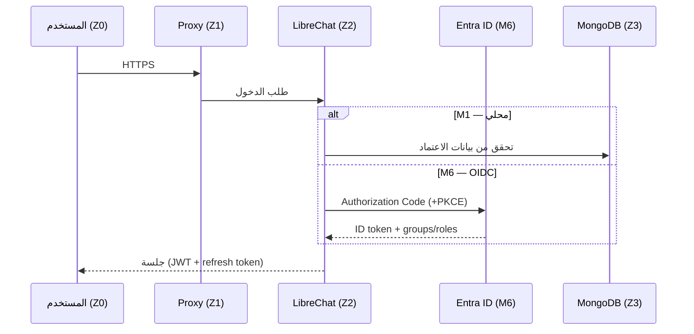

# تدفقات البيانات وحدود الثقة (Data Flows & Trust Boundaries)

| الحقل | القيمة |
|---|---|
| الحالة | Proposed |

## 1. مناطق الثقة

| المنطقة | المحتوى | الثقة |
|---|---|---|
| Z0 — العميل | متصفح الموظف | غير موثوق |
| Z1 — الحافة | Railway edge (TLS) / Caddy في الموقع (TLS) / loopback محلياً | حد الثقة الخارجي |
| Z2 — التطبيق | LibreChat | موثوق، يفرض المصادقة والصلاحيات |
| Z3 — البيانات | MongoDB، Meilisearch، pgvector، volumes | الأعلى حساسية؛ لا وصول خارجي |
| Z4 — خارجي | مزوّدو النماذج، embeddings، CDN، خوادم MCP البعيدة | خارج سيطرتنا — يخضع للتصنيف والاعتماد |

## 2. التدفقات الرئيسية

### F1 — الدخول

### F2 — محادثة مع نموذج خارجي

`U → P → L → (Z4) مزوّد النموذج → L → M (حفظ المحادثة) → U`.
**الحساسية:** نص المحادثة والملفات المرفقة يغادران البنية إلى المزوّد. على Railway كل البيانات أصلاً خارج المملكة (Z4 فعلياً) — اصطناعية فقط. يُسمح فقط بمزوّد معتمد لتصنيف البيانات المعنية (NFR-PRIV-02).
في مرحلة العرض: بيانات اصطناعية فقط.

### F3 — محادثة مع نموذج محلي

`U → P → L → نموذج محلي (شبكة خاصة) → L → M → U`. البيانات لا تغادر البنية (مفضّل للبيانات المصنفة مستقبلاً).

### F4 — رفع ملف و RAG (M4)

`U → L → volume (الملف) → rag_api → مزوّد embeddings (Z4 أو محلي) → pgvector`. عند السؤال: `L → rag_api → pgvector → L → النموذج`.
**الحساسية:** مقاطع المستند تُرسل إلى مزوّد embeddings — يخضع لـ OD-01.

### F5 — وكيل يستدعي أداة MCP (M5)

`L → خادم MCP (محلي stdio أو بعيد HTTP) → نظام الأعمال`. المخاطر: prompt injection من محتوى الأداة، صلاحيات زائدة، تسريب بيانات.
الضوابط في [security-baseline.md](../security/security-baseline.md#3-ضوابط-خاصة-بالذكاء-الاصطناعي).

### F6 — Artifacts (M4)

المتصفح يحمّل Sandpack bundler — **افتراضياً من CDN عام (codesandbox)** حسب توثيق LibreChat v0.8.8؛ قد يرسل telemetry.
يجب استضافته ذاتياً (`SANDPACK_BUNDLER_URL`) أو تعطيل القدرة قبل أي بيانات غير اصطناعية.

### F8 — البحث في الإنترنت عبر مزوّد النموذج (ADR-0015)

`L → (Z4) Qwen Cloud: النموذج يكوّن استعلاماً من المحادثة → محرك بحث المزوّد → نتائج داخل سياق النموذج → L`.
**الحساسية:** نص الاستعلام يصل محرك البحث الذي يشغّله المزوّد، إضافة إلى المحادثة التي تصله أصلاً (F2). بيانات اصطناعية فقط.
محادثة أوقف فيها الموظف «الإنترنت» لا تمر بهذا المسار (توأم بلا بحث، ADR-0015 §5).

### F7 — تغيير الإعداد

`مطوّر/وكيل AI → PR → مراجعة → main → Railway dev تلقائياً عند تغيّر مدخلات الصور (ADR-0010) / pull + up على Compose`.
المتغيرات وIaC: `railway config plan` ثم `apply` بتفويض ADR-0009. لا تعديل إعدادات يدوي في الإنتاج دون انعكاسه في المستودع (ADR-0002).

## 3. ملخص بيانات تغادر البنية

| التدفق | البيانات | الوجهة | الضابط |
|---|---|---|---|
| F2 | المحادثة والمرفقات | مزوّد النموذج | اعتماد المزوّد + التصنيف |
| F4 | مقاطع المستندات | مزوّد embeddings | اعتماد المزوّد أو embeddings محلية |
| F5 | معاملات الأدوات | خوادم MCP البعيدة | قائمة معتمدة + allowedDomains |
| F6 | كود الـ Artifact | CDN Sandpack | استضافة ذاتية أو تعطيل |
| F8 | استعلامات بحث مشتقة من المحادثة | محرك بحث مزوّد النموذج (Qwen Cloud) | اعتماد المزوّد (OD-01) + ADR-0015 + بيانات اصطناعية |
