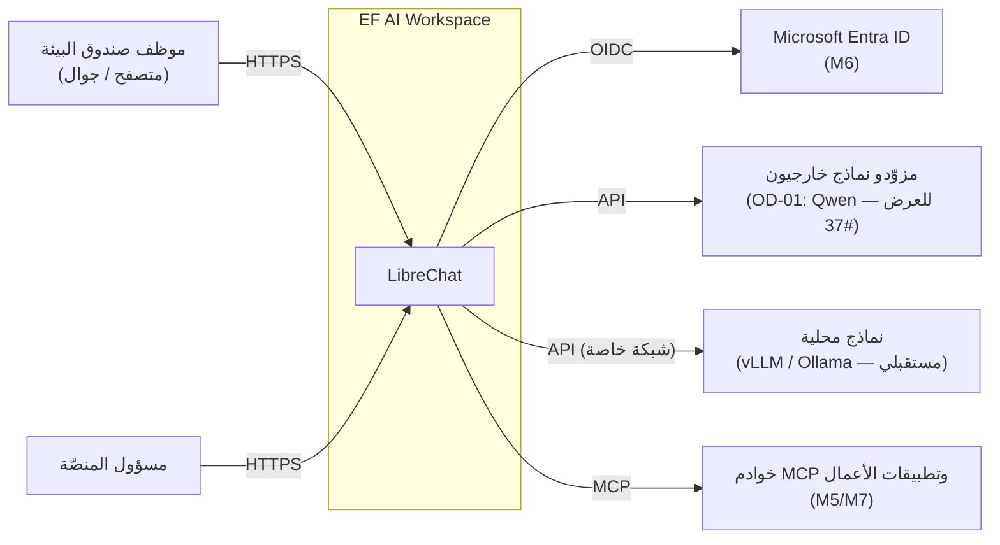

# نظرة معمارية عامة (Architecture Overview)

| الحقل | القيمة |
|---|---|
| الحالة | **2026-10-19:** LibreChat + MongoDB منشوران على Railway `dev` ببيانات اصطناعية فقط؛ Windows/Ubuntu الحقيقي غير متحقق. النماذج وRAG والوكلاء ما زالت Planned؛ الحقيقة الأحدث [CURRENT_STATE](../../project/CURRENT_STATE.md) |
| خط الأساس | LibreChat **v0.8.8** (tag 2026-09-30، `librechat.yaml` version `1.3.17`) |
| آخر تحقق من upstream | 2026-10-17 (قراءة مباشرة لمصدر v0.8.8 ومستودع التوثيق الرسمي `LibreChat-AI/librechat.ai`) |

> هذا Overview معماري، وليس سجل تنفيذ حي. الخطة المعتمدة للمنتج:
> [ROADMAP](../../project/ROADMAP.md)، والأدلة التشغيلية:
> [CURRENT_STATE](../../project/CURRENT_STATE.md). بعض صفوف القدرات أدناه تحفظ تقييم upstream
> بتاريخ 2026-10-17، ولا تعني أن كل قدرة configured في بصير.

## 1. سياق النظام (System Context)

## 2. المكونات المنطقية

| الطبقة | المكوّن | المرحلة | الحالة |
|---|---|---|---|
| التطبيق | LibreChat v0.8.8 (API + واجهة) | M1 | **Verified previously on Railway dev** (synthetic), لا LLM provider مفعّل |
| البيانات | MongoDB 8.0.34 بمصادقة (المستخدمون، المحادثات، الوكلاء، المهارات، ACL) | M1 | **Verified previously on Railway dev**؛ private network/authentication؛ backup/restore target NOT RUN |
| البحث | Meilisearch v1.54.3 (بحث المحادثات، خدمة خاصة، [ADR-0014](adr/0014-conversation-search-meilisearch.md)) | M3 — OD-02 (#4)، #125 | Implemented + Tested (cloud session)؛ الحالة الحية في CURRENT_STATE |
| المعرفة | RAG API + PostgreSQL/pgvector | M4 | Planned (اختياري حتى M4) |
| النماذج | نقاط نهاية خارجية + مخصصة متوافقة مع OpenAI | M3 | Planned |
| الهوية | محلية (عرض) ← Entra ID OIDC (إنتاج) | M1 / M6 | M1 محلية: Implemented + Tested؛ OIDC Planned |
| الوكلاء والمهارات و MCP | ميزات LibreChat المدمجة | M5 | Planned |
| البنية | Railway IaC (عرض) + Docker Compose (Windows المحلي، Ubuntu في الموقع مع Caddy HTTPS) — ADR-0008/0010 | M1/M1.1 | **Railway dev deployed** (صورة app وDB تعمل، autodeploy verified)؛ Windows/Ubuntu الحقيقيان **NOT RUN** (#17)؛ RW/backup متبقية (#15) |

التفاصيل: [HLD.md](HLD.md) · التدفقات: [data-flow.md](data-flow.md) · القرارات: [adr/](adr/README.md).

## 3. قدرات LibreChat v0.8.8 المتحقق منها

> "Verified upstream" = موجودة في المصدر/التوثيق الرسمي لـ v0.8.8. **لا يعني أنها مُعدّة أو مختبرة في مشروعنا.**

| القدرة | الدليل (v0.8.8) | الحالة لدينا | ملاحظات وفجوات |
|---|---|---|---|
| نقاط نهاية مخصصة (OpenAI-compatible) | `librechat.example.yaml` → `endpoints.custom[]`؛ `apiKey: '${ENV_VAR}'` | Planned M3 | Ollama/vLLM/LiteLLM موثقة؛ `endpoints.allowedAddresses` للعناوين الخاصة |
| Agents | `packages/data-schemas/src/models/agent.ts` (MongoDB) | Planned M5 | **لا استيراد من ملفات**؛ UI أو Agent Management API (beta، OIDC machine tokens) |
| Skills | توثيق `features/skills`؛ `POST /api/skills/import`؛ `DEPLOYMENT_SKILLS_DIR` (افتراضي `./skill`)؛ `skillSync.github` | Planned M5 | صيغة `SKILL.md`؛ المجلد المركّب للقراءة فقط ويحتاج إعادة تشغيل |
| MCP | `packages/data-provider/src/mcp.ts`: stdio, sse, streamable-http, websocket | Planned M5 | `mcpSettings.allowedDomains`؛ OAuth لكل مستخدم؛ صلاحيات `interface.mcpServers` |
| RAG | خدمة `rag_api` منفصلة + pgvector؛ `RAG_API_URL` | Planned M4 | اختيارية؛ صورة lite تتطلب embeddings عن بُعد |
| Artifacts | توثيق `features/artifacts` | Planned M4 | **Sandpack من CDN عام افتراضياً** — `SANDPACK_BUNDLER_URL` للاستضافة الذاتية |
| OIDC / Entra ID | `OPENID_*` في `.env.example`؛ صفحة Azure Entra | Planned M6 | `OPENID_REQUIRED_ROLE`, `OPENID_ADMIN_ROLE`, مزامنة الأدوار |
| SAML | `SAML_*` | غير مخطط | بديل إن لزم |
| الأدوار والصلاحيات | `SystemRoles` ADMIN/USER؛ ACL لكل مورد؛ مجموعات؛ `/api/admin/*` | لوحة الإدارة: Implemented ([ADR-0016](adr/0016-librechat-admin-panel.md))؛ RBAC المؤسسي Planned M6 | اللوحة الرسمية بحالة "Preview" (مجموعات، أدوار مخصصة، منح)؛ لا إنشاء حسابات في v0.8.8 |
| العربية / RTL | `client/src/locales/ar`؛ `i18n.dir(locale)`؛ `infrastructure/common/client` ([ADR-0013](adr/0013-arabic-web-client-build.md)) | Implemented (واجهة Railway) | Railway: ترجمة 100% والعربية افتراضية؛ Compose: upstream **~23% (692/3059 مفتاح)** |
| الهوية البصرية | `APP_TITLE`, `CUSTOM_FOOTER`, `HELP_AND_FAQ_URL`؛ `interface.customWelcome` | Planned M2 | **لا ألوان وقت التشغيل في v0.8.8**؛ لا شعار قابل للتهيئة |
| الاحتفاظ بالبيانات | `interface.generalChatRetention` / `temporaryChatRetention` / `retentionMode` | Planned M6 | القيم الافتراضية 720 ساعة؛ السياسة OD-07 |
| سجل التدقيق | `AuditLog` (hash-chained)، `/api/admin/audit-log` | Planned M6 | **يسجل 4 إجراءات إدارية فقط** — لا دخول ولا محادثات → فجوة لـ NFR-AUD-01 |
| الرصيد وحدود المعدل | `balance.*`, `rateLimits`, `LIMIT_*` | Planned M6 | — |
| فحص الصحة | `GET /health` → `200 OK` (`api/server/index.js`) | Planned M1 | ملفات Compose الرسمية بلا healthchecks |

## 4. الصور الرسمية (مرجع لـ M1)

| الصورة | المصدر | ملاحظة |
|---|---|---|
| `ghcr.io/librechat-ai/librechat:v0.8.8` | workflow `tag-images.yml` upstream | digest مسجل في 2026-10-17: `sha256:5b706bcee1ca154a1e2987303aaeca0eb27f97919cccee4bb604226c2f8abf61` — **يُعاد التحقق في M1** |
| `ghcr.io/librechat-ai/librechat-api:v0.8.8` | نفسه (API فقط، دون واجهة) | لا يُستخدم مع الواجهة المدمجة |
| `mongo:8.0.20`, `getmeili/meilisearch:v1.35.1`, `pgvector/pgvector:0.8.0-pg15-trixie` | `docker-compose.yml` upstream v0.8.8 | الإصدارات المرجعية upstream |
| `ghcr.io/librechat-ai/librechat-rag-api-dev-lite:v0.9.0` | خط إصدارات مستقل | M4 فقط |

ملفات Compose الرسمية تستخدم `registry.librechat.ai/...:latest` وصور **dev** — لن نستخدمها كما هي (ADR-0001، ADR-0007).
