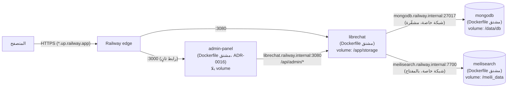

# Railway — بيئة التطوير والعرض السحابية (Environment A)

| الحقل | القيمة |
|---|---|
| القرار | [ADR-0008](../architecture/adr/0008-multi-environment-hosting-railway-windows-ubuntu.md) |
| الحالة | الحالة المتحققة في [CURRENT_STATE](../../project/CURRENT_STATE.md)؛ مصفوفة القبول الحية في [#15](https://github.com/faenazi/ef-ai-workspace/issues/15) |
| القرارات | D3 (الإعداد المستهدف) وD5 (SC-18) معتمدان وD2 معدّل (لا GitHub Actions) في [#16](https://github.com/faenazi/ef-ai-workspace/issues/16). `apply` والأسرار والنشر في `dev` مفوّضة للوكيل ([ADR-0009](../architecture/adr/0009-development-phase-agent-delegation.md))؛ **إنشاء النطاق غير مُفوّض** |
| النشر | **تلقائي من `main`** (§4، [ADR-0010](../architecture/adr/0010-railway-dev-autodeploy-from-main.md)): الخدمات الثلاث مربوطة بـ `faenazi/ef-ai-workspace` فرع `main`، Wait for CI مُطفأ، وwatch paths = مدخلات صورة كل خدمة؛ المتغيرات بـ `config apply` فقط؛ `railway-deploy.sh` للطوارئ والرجوع |
| التعريض العام | رابطا `*.up.railway.app`: LibreChat، ولوحة الإدارة ([ADR-0016](../architecture/adr/0016-librechat-admin-panel.md)، تفويض المالك 2026-10-23 في [#141](https://github.com/faenazi/ef-ai-workspace/issues/141))؛ كلاهما مشروط ببوابة SC-18 لكل ثغرة حرجة ([سجل الثغرات](../security/vulnerability-register.md)) |
| البيانات | **اصطناعية فقط.** Railway خارج المملكة (لا منطقة في الشرق الأوسط)؛ ليست بيئة إنتاج |
| آخر تحقق من مصدر Railway | 2026-10-18 — `railwayapp/docs` (`7235449`)، SDK `railway@3.16.0`، CLI v5.70.0 |

> **قاعدة:** `config apply` والأسرار ونشر commits من `main` في بيئة `dev` فقط، بتفويض ADR-0009، وتُسجّل على #15. أي نطاق أو بيئة
> أخرى أو مشروع جديد أو تغيير في الإنفاق يحتاج تفويضاً صريحاً من المالك. الوكيل يستخدم project token لبيئة `dev` فقط.

## 1. الطوبولوجيا

| الخدمة | البناء | Volume (واحد لكل خدمة) | الشبكة | Healthcheck |
|---|---|---|---|---|
| `librechat` | `infrastructure/railway/librechat.Dockerfile` (FROM digest v0.8.8؛ واجهة الويب العربية تُبنى في المرحلة نفسها، [ADR-0013](../architecture/adr/0013-arabic-web-client-build.md)) | `librechat-storage` (5 GB) → `/app/storage` | نطاق عام مُولّد فقط، المنفذ 3080 | `/health` (300 ث) |
| `mongodb` | `infrastructure/railway/mongodb.Dockerfile` (FROM digest 8.0.34) | `mongodb-data` (5 GB) → `/data/db` | **خاص فقط**: لا نطاق، لا TCP proxy | لا (ليست HTTP) |
| `meilisearch` | `infrastructure/railway/meilisearch.Dockerfile` (FROM digest v1.54.3، [ADR-0014](../architecture/adr/0014-conversation-search-meilisearch.md)) | `meilisearch-data` (5 GB) → `/meili_data` | **خاص فقط**: لا نطاق، لا TCP proxy | لا |
| `admin-panel` | `infrastructure/railway/admin-panel.Dockerfile` (FROM digest `82fb4b6`، بناء أمني مؤقت، [ADR-0016](../architecture/adr/0016-librechat-admin-panel.md)) | لا شيء (الجلسة كوكي مشفّر) | نطاق عام مُولّد يدوياً (منفذ 3000) بعد SC-18؛ يصل LibreChat عبر الشبكة الخاصة | `/health` |

**لماذا صور مشتقة؟** Railway لا يدعم ربط ملفات (bind mounts) ويسمح بـ volume واحد لكل خدمة. الصور لا تغيّر كود LibreChat؛
تضيف فقط: `librechat.yaml`/`mongo-init/` من `infrastructure/common/`، وحارس بدء يرفض التشغيل دون الأسرار (فلا يُهيّأ volume MongoDB
دون مصادقة ولا تعمل Meilisearch دون مفتاح)، وتخطيط التخزين أدناه، وإسقاط صلاحيات LibreChat إلى المستخدم `node`.
صورة اللوحة استثناء مؤقت: تُبنى من مصدرها بنسخ حزم مُصلحة فقط (CVE-2026-102989)، ويُزال الاستثناء عند إصلاح upstream (ADR-0016).

### تخطيط التخزين (volume واحد لـ LibreChat)

| المسار في التطبيق | يشير إلى | يُنسخ احتياطياً | ملاحظة |
|---|---|---|---|
| `/app/uploads` | `/app/storage/uploads` | نعم | الملفات المرفوعة (ومجلد `temp` للرفع) |
| `/app/client/public/images` | `/app/storage/images` | نعم | الصور الرمزية والصور المولّدة. الصورة الرسمية تشحن هذا المسار **فارغاً** (لا أصول تُفقد بالرابط الرمزي — R31)؛ الملفات تُخدم عبر `/images/…` بمصادقة الجلسة (R32) |
| `/app/data` | `/app/storage/data` | نعم | سجلات المخالفات/الحظر وبيانات plugins |
| `/app/logs` | ليس في الـ volume | لا — **مستبعد عمداً** | Railway يجمع stdout؛ ملفات السجل غير لازمة للاستعادة؛ التجميع المركزي M6 |
| `/app/librechat.yaml` | داخل الصورة (قراءة فقط) | Git | يتغير فقط بـ PR + إعادة بناء |

الروابط الرمزية تُنشأ **وقت البناء**؛ حارس البدء ينشئ المجلدات الفرعية ويصحح الملكية (للعناصر غير المملوكة لـ `node` فقط) ثم يشغّل
LibreChat كـ `node`. مُختبر: R20–R24 (رفع صورة حقيقية عبر LibreChat تُكتب في الـ volume وتبقى بعد إعادة النشر).

## 2. المتطلبات المسبقة (المالك)

قائمة التحقق الكاملة في [#15](https://github.com/faenazi/ef-ai-workspace/issues/15). الإعداد المستهدف **المعتمد** (D3 في [#16](https://github.com/faenazi/ef-ai-workspace/issues/16)):

| البند | القيمة المعتمدة | الحالة |
|---|---|---|
| الاشتراك | Railway Pro، تطوير/عرض ببيانات اصطناعية فقط | المالك |
| المنطقة | `europe-west4-drams3a` (أمستردام) | في `railway.ts`، يُفرض بـ `railway_checks.py` |
| الموارد | librechat 2 vCPU / 2 GB، mongodb 1 vCPU / 1 GB، meilisearch 1 vCPU / 1 GB ([#125](https://github.com/faenazi/ef-ai-workspace/issues/125))، admin-panel 1 vCPU / 512 MB ([#141](https://github.com/faenazi/ef-ai-workspace/issues/141))، نسخة واحدة لكل خدمة (تقديرات تجريبية، ليست اختبار حمل) | في `railway.ts`، مفروض |
| التخزين | 5 GB أولية لكل volume (واحد لكل خدمة)؛ مراقبة السعة ومراجعة أي توسعة | في `railway.ts`، مفروض |
| الإنفاق | Workspace **Compute Hard Limit $30** و**Email Alert $15** | **NOT VERIFIED** — يضبطها المالك في Railway ويتحقق من حفظها؛ ليست IaC |
| النشر | **تلقائي** عند push إلى `main` يمس صورة الخدمة؛ لا Wait for CI ([ADR-0010](../architecture/adr/0010-railway-dev-autodeploy-from-main.md)، يحل محل «يدوي فقط» في D2) | المصدر وwatch paths مفروضان بـ `railway_checks.py` (اختبارات سلبية N01–N03، N17)؛ الحالة الحية في #15 |
| النسخ | Daily + Weekly لـ volumes `mongodb` و`librechat` بعد النشر المُفوّض + نسخة استرداد مشفّرة للمفاتيح يملكها المالك؛ volume `meilisearch` مشتق ولا يحتاج نسخاً (§3) | إجراء |
| الرابط العام | `*.up.railway.app` لـ LibreChat ولوحة الإدارة، بعد فحص جديد وقرار SC-18 لكل ثغرة | لا CRITICAL في صورة LibreChat (ADR-0012) ولا في صورة اللوحة المشتقة (ADR-0016)؛ R-05 غير متأثرة؛ فحص أسبوعي مستمر |

**Railway GitHub App مطلوب (ADR-0010):** يمنحه المالك وصولاً إلى `faenazi/ef-ai-workspace` **فقط** (Only select repositories)،
ويكون حسابه في Railway مربوطاً بـ GitHub بصلاحية على المستودع؛ دون ذلك يفشل `config apply` للمصدر أو لا يعمل autodeploy.

## 3. أول نشر (بعد التفويض فقط)

أُنشئت البيئة مرة واحدة في 2026-10-19 (المشروع والخدمتان والـ volumes والأسرار موجودة، والنشر التلقائي من `main` مفعّل)؛ سجل
الإجراءات في [docs/history/railway-first-deploy-2026-10-19.md](../history/railway-first-deploy-2026-10-19.md). **لا تُعد**
`railway config apply` لإنشاء الموارد ولا `railway-secrets.sh` لتوليد أسرار جديدة بغرض فحص الحالة (قد يسبب تغييراً غير مقصود أو
فقدان القدرة على الاستعادة)؛ للقراءة دون تغيير: `railway status` و`railway config plan` بصلاحية بيئة `dev`.
`config plan/apply` يقرأ `.railway/railway.ts` بحزمة `railway` المثبتة (`npm ci` داخل `.railway/`)، وهي تتحقق من إصدار CLI بتشغيل
`$_`: من غير shell تفاعلي (مثل `npx`) يفشل الأمر بـ «requires Railway CLI 5.42.1»، فشغّله `env _=$(command -v railway) railway config plan`.

**الأسرار:** `MONGO_INITDB_ROOT_*` و`MONGO_APP_PASSWORD` (mongodb)، `MEILI_MASTER_KEY` (meilisearch)، `CREDS_KEY/IV` و`JWT_*` و`QWEN_API_KEY` (librechat؛ مفتاح المزوّد يضيفه المالك من لوحة Railway، #37)، `SESSION_SECRET` (admin-panel).
`ADMIN_PANEL_URL` (librechat) و`API_SERVER_URL`/`VITE_API_BASE_URL` (admin-panel) مراجع Railway فقط. `MONGO_URI` يُبنى بمتغيرات مرجعية
`${{mongodb.…}}` على النطاق الخاص، و`MEILI_HOST`/`MEILI_MASTER_KEY` بمراجع `${{meilisearch.…}}`؛
`DOMAIN_CLIENT/SERVER` = `https://${{RAILWAY_PUBLIC_DOMAIN}}`. لا قيمة سرية في Git.
**قبل إنشاء النطاق العام** يعرض Railway هذه القيمة `https://` فقط، وLibreChat يرفض البدء (`Failed to start server: Invalid URL` — أول نشر
2026-10-19). حارس البدء `librechat-start.sh` يحوّلها حينها إلى العنوان الخاص `http://librechat.railway.internal:3080` ويسجّل ذلك؛ وعند
توليد النطاق يأخذ مكانه تلقائياً في النشر التالي دون أي تغيير (اختبار R33 في المحاكاة).
**تحذير:** تدوير `CREDS_KEY/IV` يجعل بيانات الاعتماد المخزنة غير مقروءة — `railway-secrets.sh` لا يدوّرها أبداً، وLibreChat v0.8.8
يسجّل تحذير `do not match the database credential record` عند اختلاف المفاتيح عن بصمتها في القاعدة (مُختبر R30).
**نسخ Railway الاحتياطية للـ volumes لا تشمل المتغيرات:** الاستعادة الكاملة = volume backup + نسخة الاسترداد المشفّرة للأسرار.

### إضافة البحث في المحادثات إلى بيئة قائمة ([#125](https://github.com/faenazi/ef-ai-workspace/issues/125)، [ADR-0014](../architecture/adr/0014-conversation-search-meilisearch.md))

1. `railway config plan` ثم `apply`: يُنشئ خدمة `meilisearch` وvolume الخاص بها، ويغيّر `SEARCH` و`ALLOW_SHARED_LINKS` ويضيف `MEILI_*` إلى librechat.
2. `scripts/setup/railway-secrets.sh --accept-no-recovery`: يضيف `MEILI_MASTER_KEY` وحده (القائم لا يُكتب فوقه أبداً). لا يلزم نسخ
   استرداد له: الفهرس يُعاد بناؤه، والمفتاح الجديد يكفي. `--from-recovery` بنسخة قديمة بلا هذا المفتاح يولّد مفتاحاً جديداً (R39).
3. إعادة نشر `meilisearch` ثم `librechat`: أول إقلاع يفهرس كل المحادثات القائمة (لا علامات `_meiliIndex` عليها بعد).
   شرط ذلك أن يكون `librechat` قد بدأ و`meilisearch` يعمل. إن بدأ قبله ثم كُتبت رسالة واحدة تُفهرس، فإن الإعداد الافتراضي لـ upstream
   (`MEILI_SYNC_THRESHOLD=1000`) يتخطّى الباقي ما دام أقل من 1000، وهذا ما حدث على `dev` في 2026-10-22 (#135). لذلك
   `MEILI_SYNC_THRESHOLD=0` في `librechat.env`: كل إقلاع يفهرس أي محادثة ناقصة.

**ضياع volume Meilisearch:** إعادة نشر `librechat` تكفي؛ أول إقلاع على فهرس فارغ يعيد بناءه من MongoDB (M55).
**استعادة MongoDB:** LibreChat يحفظ علامة «مُفهرس» في MongoDB، فالمحادثات المستعادة قد لا تظهر في البحث. شغّل داخل خدمة `mongodb`
(`railway ssh --service mongodb`) أمر `updateMany` نفسه في `scripts/operations/search-reindex.sh` بصفة مستخدم التطبيق، ثم أعد نشر
`librechat` (مُختبر في Compose: M56).

### إضافة لوحة الإدارة إلى بيئة قائمة ([#141](https://github.com/faenazi/ef-ai-workspace/issues/141)، [ADR-0016](../architecture/adr/0016-librechat-admin-panel.md))

تفويض المالك 2026-10-23: خدمة `admin-panel` برابط Railway مُولّد، بحد 1 vCPU / 512 MB، بشرط SC-18.

1. `railway config plan` ثم `apply`: يُنشئ خدمة `admin-panel` (بلا volume) ويضيف `ADMIN_PANEL_URL` إلى librechat.
2. `scripts/setup/railway-secrets.sh --accept-no-recovery`: يضيف `SESSION_SECRET` وحده. لا يلزمه نسخ استرداد، فالقيمة الجديدة تُنهي
   جلسات المسؤولين المفتوحة فقط (R39).
3. انتظار نشر `admin-panel` (`/health`)، ثم Trivy على `admin-panel.Dockerfile` كما بُني: **0 CRITICAL شرط للرابط** (سجل الثغرات R-06–R-08).
4. توليد الرابط: Settings → Networking → Generate Domain على المنفذ **3000**. التفويض في #141، وليس IaC.
5. إعادة نشر `librechat` ليحلّ `ADMIN_PANEL_URL`. قبل الرابط يتركه `librechat-start.sh` فارغاً (R33).
6. التحقق: سجل الإقلاع، والدخول بحساب المسؤول من الجوال، وظهور «لوحة المسؤول» في الإعدادات ← عام، ثم
   `scripts/operations/admin-config-drift.sh --railway` (يحتاج مفتاح SSH مسجلاً في Railway).

## 4. النشر — تلقائي من `main` (ADR-0010)

قرار المالك (2026-10-19): النشر التلقائي عند أي تعديل على `main` — يحل محل «النشر اليدوي فقط» في D2 المعدّل ([#16](https://github.com/faenazi/ef-ai-workspace/issues/16)).
GitHub Actions ما زال غير مستخدم، لذلك **الضابط الوحيد قبل النشر هو مراجعة الوكيل وتحققه قبل الدمج**: أي تغيير في watched paths
يُعامل كتغيير بنية تحتية (فهم أثر النشر، والفحوصات ذات الصلة) وفق [ADR-0011](../architecture/adr/0011-production-only-quality-gates.md) و[DoD](../quality/definition-of-done.md).

| الطبقة | الضبط | من يفرضه |
|---|---|---|
| IaC | الخدمات الأربع: `source: github("faenazi/ef-ai-workspace", { branch: "main", checkSuites: false })` — لا Wait for CI | `railway.ts`؛ `railway_checks.py` يقبل هذا المصدر حرفياً فقط (اختبارات سلبية N01–N03: فرع آخر، Wait for CI، مصدر صورة) |
| Watch paths | لكل خدمة: الـ Dockerfile ومصادر `COPY` فيه فقط (`librechat`: `client/**` و`librechat.yaml` و`librechat-start.sh`؛ `mongodb`: `mongo-init/**` و`mongodb-start.sh`؛ `meilisearch`: `meilisearch-start.sh`؛ `admin-panel`: `admin-panel/patches/**` و`admin-panel-start.sh`). تغييرات التوثيق والفحوصات وCompose **لا تنشر** | `railway_checks.py` يشتقها من الـ Dockerfile ويفرض التطابق (N17) |
| المتغيرات | سياسة `librechat.env` → متغيرات `railway.ts`، والأسرار: **لا** تُطبّق بالـ push؛ `railway config plan` ثم `apply` (ADR-0009) | الوكيل بعد الدمج |
| لوحة Railway | Railway GitHub App بوصول إلى هذا المستودع فقط؛ autodeploy مفعّل | **المالك** (§2) |
| الطوارئ/الرجوع | `scripts/setup/railway-deploy.sh --commit <SHA>` يرفع commit محدداً من `main` بـ `railway up` | مُختبر بـ CLI وهمي (D01–D08) |

المرجع (`railwayapp/docs` @ `7235449`): [Controlling GitHub Autodeploys](https://docs.railway.com/deployments/github-autodeploys)
(Wait for CI يتطلب GitHub Actions؛ autodeploy يتطلب عضواً بحساب GitHub له صلاحية على المستودع)؛
[Build configuration — watch paths](https://docs.railway.com/builds/build-configuration#configure-watch-paths) (أنماط gitignore من `/`)؛
Volumes reference: إعادة نشر خدمة لها volume تسبب **توقفاً قصيراً** حتى مع healthcheck.

- **الرجوع (rollback):** revert على `main` (يُنشر تلقائياً إن مس الصورة)، أو Deployments → نشر سابق ناجح → Redeploy، أو
  `railway-deploy.sh --commit <SHA أقدم على main>`. لإيقاف autodeploy فوراً: Settings → Source → **Disable** (ثم PR يُعيد `railway.ts`).
  للرجوع عن متغير سياسة (مثل `APP_TITLE`): revert على `main` ثم `config plan`؛ حذف متغير في IaC عملية **destructive** تتطلب
  `config apply --confirm-destructive` (README حزمة `railway` 3.16.0)، والبديل غير الهدّام: إعادة القيمة السابقة صراحةً في PR.
- **انتشار التغييرات:** تغييرات الصورة تُنشر تلقائياً بالدمج. تغييرات المتغيرات أو `railway.ts` تحتاج `config plan/apply` بعد الدمج
  (يُعيد النشر؛ RW13). `railway_checks.py` يمنع الانحراف داخل المستودع لا بين المستودع وRailway — لذلك يُشغَّل `plan` بعد كل دمج يمس `railway.ts` أو `librechat.env`.
- **حدود:** تغيير الـ digest في `compose.yaml` وحده لا يُنشر؛ المعتمد سطر `FROM` في Dockerfile الخدمة (الفحص يفرض تطابقهما، فيتغيران معاً).
- Workflow `railwayapp/config` (تطبيق الخطة عند الدمج) **غير مستخدم** (يتطلب Actions).

## 5. التحقق الثابت (دون token)

`python scripts/validate/railway_checks.py` (في CI job `railway-iac` و`run-all.sh`):
يقيّم `railway.ts` offline بنفس طريقة Railway CLI وبالـ SDK المثبت، يفحص الأنواع (`tsc`)، ويفرض: أربع خدمات، volume واحد لكل خدمة بيانات بالمسار الصحيح ولا volume للوحة،
نسخة واحدة، لا TCP proxy ولا أي نطاق (مُولّد أو مخصص)، `/health`، **مصدر النشر = هذا المستودع فرع `main` دون Wait for CI، وwatch paths = مدخلات الـ Dockerfile** (ADR-0010)، أهداف D3 حرفياً، الأسرار `preserve()` فقط (ومفتاح Meilisearch في librechat مرجع فقط)، سياسة
التطبيق = `librechat.env`، مساواة الـ digest مع Compose، وغياب `railway.json`/`railway.toml` (deprecated، قطع نهائي 2026-12-01).
الاختبارات السلبية: `tests/policy/negative-checks.sh` (33 حالة: مصدر نشر غير معتمد أو watch paths ناقصة، انحراف D3، تعريض قاعدة البيانات أو فهرس البحث، نطاق عام، أسرار في Git،
Config as Code، إضعاف Compose، عزل لوحة الإدارة وحارس خروجها). محاكاة التشغيل: `tests/smoke/railway-emulation.sh`؛ مسار النشر اليدوي: `tests/smoke/railway-manual-deploy.sh` (§ testing-strategy).

## 6. حالة التحقق على Railway

الحالة الحية لاختبارات القبول RW1–RW13 وAD01/AD02 في [#15](https://github.com/faenazi/ef-ai-workspace/issues/15)، وملخصها
المتحقق في [CURRENT_STATE](../../project/CURRENT_STATE.md). ما أجراه الوكيل في Linux (Compose، المحاكاة) لا يُحسب تحققاً على
Windows أو Ubuntu الحقيقي ([#17](https://github.com/faenazi/ef-ai-workspace/issues/17)). `config plan` يُظهر فرقاً شكلياً معروفاً في
`restartPolicy` (`null`)؛ ليس موافقة على اختلاف فعلي. **Railway EU West: بيانات اصطناعية فقط؛ لا هويات Entra ولا وثائق حقيقية.**
