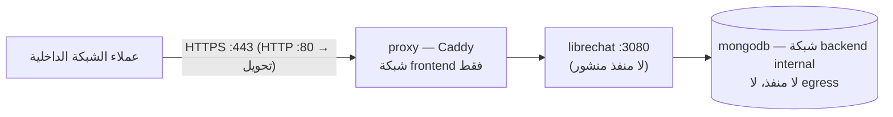

# Ubuntu Server — الاستضافة الداخلية في الموقع (Environment C)

| الحقل | القيمة |
|---|---|
| القرار | [ADR-0008](../architecture/adr/0008-multi-environment-hosting-railway-windows-ubuntu.md)؛ قابلية النقل [ADR-0005](../architecture/adr/0005-portable-container-architecture.md) |
| الحالة | الحزمة مع وكيل HTTPS **`Tested (cloud session)`** (43 فحصاً)؛ **خادم حقيقي NOT RUN** — [#17](https://github.com/faenazi/ef-ai-workspace/issues/17) |
| البيانات | اصطناعية فقط حتى اعتماد بوابات M6 (SSO، RBAC، تدقيق، نسخ مشفّر مجدول) وM8 (OD-04/OD-05). **لا ادعاء جاهزية إنتاجية** |

لا اعتماد على Railway أو Coolify أو أي لوحة: Docker Engine + Compose plugin فقط. لا Kubernetes ولا HA (غير مُنفّذين).

## 1. الطوبولوجيا



`compose.yaml` + `compose.onprem.yaml`: الخدمة الوحيدة ذات المنافذ هي `proxy` (80/443). volumes مسماة:
`mongodb-data`، `librechat-uploads/images/logs/data`، `caddy-data/config`.

## 2. متطلبات الخادم (مسؤولية تقنية المعلومات — لا يُفترض وجودها)

| البند | القيمة |
|---|---|
| النظام | Ubuntu Server 22.04/24.04 LTS، amd64 أو arm64؛ CPU يدعم AVX (MongoDB 5+) |
| الموارد (مقترح، غير مُتحقق تحت حمل) | 2–4 vCPU، 8 GB RAM، ≥ 40 GB SSD (الصور ~6 GB وتتضاعف مؤقتاً أثناء الترقية؛ الخمول ~0.75 GB RAM) |
| Docker | Docker Engine + `docker-compose-plugin` 2.24+ من مستودع Docker الرسمي |
| DNS داخلي | اسمان يشيران للخادم: المنصة (مثل `ai-workspace.<internal-domain>`) ولوحة الإدارة (افتراضياً `admin.<الاسم الأول>`، [ADR-0016](../architecture/adr/0016-librechat-admin-panel.md)) — **TBD** |
| شهادة TLS | من CA المؤسسية (موصى به)، تغطي الاسمين (SAN) — **TBD** |
| إقامة البيانات | داخل المملكة وفق OD-05 / NFR-RES-01 |

## 3. التثبيت

```bash
git clone https://github.com/faenazi/ef-ai-workspace.git /opt/ef-ai-workspace && cd /opt/ef-ai-workspace
scripts/setup/new-env.sh onprem --hostname ai-workspace.internal.example     # أسرار جديدة لهذه البيئة فقط؛ اللوحة admin.<الاسم>
install -d -m 700 infrastructure/compose/tls                                  # ضع fullchain.pem و privkey.pem هنا (chmod 600)
cd infrastructure/compose
docker compose -f compose.yaml -f compose.onprem.yaml up -d
docker compose -f compose.yaml -f compose.onprem.yaml ps                      # الخدمات الأربع healthy
curl -fsS https://ai-workspace.internal.example/health                        # OK
```

ثم أول مسؤول ([deployment.md §3](deployment.md#3-إنشاء-أول-مسؤول-كل-البيئات)). احفظ `CREDS_KEY/CREDS_IV` من `.env` في مخزن أسرار معتمد.
`.env` أُنشئ قبل البحث في المحادثات (#125) يحتاج المفتاح مرة واحدة: `echo "MEILI_MASTER_KEY=$(openssl rand -hex 32)" >> .env`.

### TLS (`EFAIW_TLS` في `.env`)

| القيمة | الاستخدام |
|---|---|
| `/etc/caddy/tls/fullchain.pem /etc/caddy/tls/privkey.pem` (افتراضي `new-env.sh`) | **موصى به:** شهادة CA المؤسسية في `EFAIW_TLS_DIR` (افتراضي `./tls`، مُتجاهل في Git، قراءة فقط داخل الحاوية) |
| `internal` | CA داخلية لـ Caddy — مختبر/تجربة فقط؛ يجب أن يثق العملاء بجذرها (`/data/caddy/pki/authorities/local/root.crt` في volume `caddy-data`) — هذا ما يختبره smoke test |
| بريد إلكتروني (ACME) | فقط لاسم قابل للحل عاماً — غير متوقع لبيئة داخلية |

Caddy يحوّل HTTP→HTTPS، يضيف HSTS و`nosniff`، يحذف `Server`، ويتجاهل `X-Forwarded-For` القادم من العميل (قفزة وكيل واحدة، `TRUST_PROXY=1`).

## 4. تقوية الخادم (Host hardening checklist)

- [ ] SSH بالمفاتيح فقط، تعطيل دخول root بكلمة مرور، تقييد SSH لشبكة الإدارة.
- [ ] جدار ناري (`ufw`/الشبكة): وارد 443 (و80 للتحويل) من شبكات المستخدمين فقط؛ **لا 3080 ولا 27017**. Docker يتجاوز قواعد `ufw`
      للمنافذ المنشورة — اضبط `EFAIW_BIND_ADDRESS` على عنوان الواجهة الداخلية واعتمد جدار الشبكة.
- [ ] `unattended-upgrades` للتحديثات الأمنية؛ إعادة تشغيل مجدولة.
- [ ] مستخدمو مجموعة `docker` = root فعلياً: قصرها على المشغّلين المعتمدين.
- [ ] `/opt/ef-ai-workspace/infrastructure/compose/.env` و`tls/` بصلاحيات 600/700 لمالك الخدمة.
- [ ] مزامنة الوقت (chrony)، ومساحة قرص حرة ≥ 20%.
- [ ] فصل بيانات اعتماد التطوير والإنتاج: كل بيئة `.env` مولّد خصيصاً؛ لا نسخ من Windows/Railway.

## 5. التشغيل اليومي

| المهمة | الأمر / المرجع |
|---|---|
| اختصار | `alias efc='docker compose -f compose.yaml -f compose.onprem.yaml'` (من `infrastructure/compose`) |
| الحالة والسجلات | `efc ps`، `efc logs --tail 200 librechat` (json-file 10 MB × 5 لكل خدمة) |
| النسخ والاستعادة | `scripts/operations/backup.sh` / `restore.sh` — [runbook §2](runbook.md#2-النسخ-الاحتياطي-والاستعادة) |
| الترقية والتراجع | [runbook §3–§4](runbook.md#3-الترقية-upgrade) |
| المراقبة | نقاط تكامل: `GET /health`، healthchecks في `docker ps`، سجلات Docker (json-file → محوّل syslog/agent لاحقاً)، `/metrics` بـ `METRICS_SECRET` (غير مُفعّل) — الأداة M6 (NFR-OBS-01) |

## 6. مسار المستقبل

نماذج داخلية (vLLM/Ollama) على شبكة خاصة تُضاف كـ endpoint في `librechat.yaml` مع `endpoints.allowedAddresses` (M3)؛ بيئات متعددة
(dev/test/prod) = نسخ مستقلة بملفات `.env` مختلفة وأسماء مشاريع Compose مختلفة (`-p`)؛ المرشح الإنتاجي يُحسم في OD-05.
